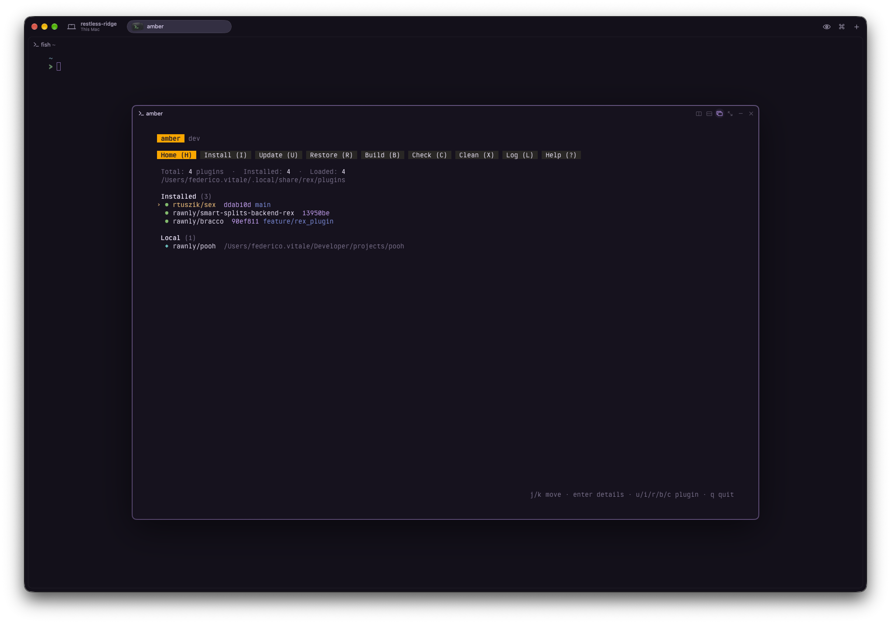

<h1 align="center">Amber</h1>

<p align="center">
  A plugin manager for <a href="https://www.superlogical.com/rex">Rex</a>, in the style of lazy.nvim.<br>
  <em>Plugins and versions stay locked, like insects in amber.</em>
</p>

<h4 align="center">
  <a href="#-install">Install</a>
  ·
  <a href="#-quick-start">Quick start</a>
  ·
  <a href="#-configuration">Configure</a>
  ·
  <a href="docs/plugin-authoring.md">Write a plugin</a>
</h4>

<p align="center">
  <a href="https://github.com/rawnly/amber/actions/workflows/ci.yml"></a>
  <a href="https://github.com/rawnly/amber/releases/latest"></a>
  <a href="https://github.com/rawnly/amber/pulse"></a>
  <a href="LICENSE"></a>
</p>

<p align="center">
  
</p>

**Amber** installs GitHub Lua plugins on the machine running the Rex server and loads them from your Rex config. Nothing installs behind your back: config load only loads, `amber install` installs.

## ✨ Features

- 📝 **Lua specs**: declare plugins in your Rex config, like lazy.nvim.
- 🔒 **Reproducible**: semver versions and a lockfile, `amber-lock.json`, that is safe to commit.
- 🛠 **Build steps**: run a shell command or a Lua function after install or update.
- 💻 **Plugin window**: the `amber` command shows a lazy.nvim-style window, which Rex actions open in a floating pane.
- 📁 **Monorepos**: load several plugins from subdirectories of one repository.
- 🤖 **Agent skill** for writing Amber plugins.

## 📋 Requirements

- macOS or Linux, on the machine running the Rex server
- Git and a POSIX shell

## 📦 Install

#### Via [Homebrew](https://brew.sh)

```sh
brew tap rawnly/amber https://github.com/rawnly/amber
brew trust rawnly/amber
brew install amber-rex
```

#### Via the installer

```sh
curl -fsSL https://raw.githubusercontent.com/rawnly/amber/main/install.sh | sh
```

<details>
<summary>Homebrew notes</summary>

- Recent Homebrew versions refuse formulae from a tap you have not trusted, hence `brew trust`.
- The formula is named `amber-rex` because Homebrew's own `amber` formula (a Crystal framework) also installs an `amber` command, and the two conflict.
- The install prints the line to put in your Rex config (also shown by `brew info amber-rex`). Its path, `$(brew --prefix)/opt/amber-rex/libexec/amber.lua`, does not change when you upgrade.
- Homebrew puts `amber` on your `PATH`. Update with `brew upgrade amber-rex`.

</details>

<details>
<summary>Installer notes</summary>

- It clones Amber to `~/.local/share/rex/amber` and downloads the `amber` command for your platform from the latest release into its `bin/`. It checks the SHA-256 checksum and moves the checkout to the matching release tag.
- Without a release for your platform, it says so; build the command with `mise run cli:build` in that directory.
- From a terminal, it asks you to confirm the directory. Answer `n` (or start with a directory that already exists) to type another absolute path; `~/` is expanded. Without a terminal (output redirected or no `/dev/tty`), it installs to the default without asking.
- Set `AMBER_INSTALL_DIR=/absolute/path` to change the default.
- It does not touch your Rex config and refuses to overwrite an existing directory.
- To inspect it first, download `install.sh` and run `sh install.sh`.

</details>

> [!TIP]
> The installer puts the command at `~/.local/share/rex/amber/bin/amber`. Add that directory to your `PATH` to type just `amber`.

## 🚀 Quick start

Add Amber to your Rex config (`~/.config/rex/init.lua` by default). With Homebrew, use the `dofile` path the install printed:

```lua
local amber = dofile(os.getenv("HOME") .. "/.local/share/rex/amber/amber.lua")

amber.setup({
  plugins = {
    { "rawnly/smart-splits-backend-rex", main = "smart-splits-rex", opts = { resize_amount = 3 } },
  },
})
```

Then reload once so Rex loads Amber, and install:

```sh
rex config reload
amber install
```

`amber install` clones the plugins, records them in the lockfile, and reloads Rex so they load.

> [!NOTE]
> Config load and `rex config check` never install anything. Run `amber install` after adding a plugin.

This example registers the Rex actions of [smart-splits-backend-rex](https://github.com/rawnly/smart-splits-backend-rex). It adds no key bindings. For Neovim you also need its Neovim plugin; see its README.

## 💻 Usage

```sh
amber                          # open the plugin window
amber install                  # clone missing plugins
amber update owner/repo        # update one plugin
amber outdated                 # see what an update would change
amber list --json              # plugin state for scripts
amber doctor                   # check that everything is wired up
```

| Command | What it does |
| --- | --- |
| `install [plugin]` | Clones missing plugins. Uses the locked commit when there is one; otherwise records the new commit. |
| `update [plugin]`, `up` | Moves plugins to the newest commit or version and rewrites their lock entries. Never resets local changes. |
| `restore [plugin]` | Checks out the locked commits, installing missing ones. Refuses dirty checkouts. |
| `build [plugin]` | Runs build steps, even if they already ran for the locked commit. |
| `outdated [plugin]`, `check` | Fetches and shows what an update would change. Changes nothing. |
| `list`, `ls` | Lists plugins with load status, commit, and version. Reads local state only. |
| `doctor` | Checks Git, the Rex connection, the library version, the lockfile, leftover directories, and every plugin. |
| `clean` | Removes undeclared checkouts and leftovers after asking. `--dry-run`, `--yes`, and `--lock` (also drop their lock entries). |
| `self-update` | Updates the command and the library. See [Updating Amber](#-updating-amber). |

```
  -j, --jobs int        how many plugins to work on at once (default 4)
      --no-reload       don't reload the Rex config after plugins change
      --plain           print plain lines instead of opening the plugin window
      --server string   Rex server address: socket path, unix:// URL, or host:port
                        (default $REX_SERVER or the local socket)
```

On a terminal, `install`, `update`, `restore`, `build`, and `outdated` open the plugin window and start right away. Piped, or with `--plain`, they print one line per plugin and exit nonzero if any plugin failed. After anything changes, Amber reloads the Rex config. Reloading only works over the local socket, so run `amber` on the Rex server machine.

Unversioned plugins update with `git pull --ff-only`. Versioned ones fetch tags and check out detached.

### Plugin window

Plugins are grouped like in lazy.nvim: Working, Failed, Updated, Updates available, Needs attention, Not installed, Installed, Local, and Disabled. Each row shows the commit and version, and progress while Git or a build runs.

| Key | Action |
| --- | --- |
| `I` `U` `R` `B` `C` | Install, update, restore, build, or check every plugin |
| `i` `u` `r` `b` `c` | The same for the plugin under the cursor |
| `X` | Clean, after showing what would be removed |
| `enter` | Details: paths, commits, new commits, recent output |
| `j` `k`, `g` `G` | Move; first and last |
| `L` | Git, build, and Rex reload output |
| `?` | Help |
| `q` | Quit. While plugins run, press it twice; that cancels them |

### Rex actions

Use these in the command palette or a key binding. Each opens `amber` in a centered floating pane at 75% of the window, which closes when you quit.

| Action | Opens |
| --- | --- |
| `amber` | The plugin window |
| `amber_install`, `amber_update`, `amber_restore`, `amber_build` | The window, running that operation. Optional `plugin=owner/repo`. |
| `amber_outdated` | The window, checking for updates |
| `amber_clean` | The clean view |
| `amber_status` | Nothing: returns load status, errors, path, commit, lock match, build state, and version match. Does not fetch. |

The pane actions need a Rex session, so `rex do amber_update` from a plain shell fails and suggests the `amber` command instead. `amber_info` and `amber_lua_build` are internal. Load failures also go to `rex.log`; see [Rex logs](https://www.superlogical.com/rex/docs/linux/shared-server#logs).

## 🔧 Configuration

A plugin is `"owner/repo"` or a table whose first element is that name. Unknown options are rejected.

| Option | Default | Meaning |
| --- | --- | --- |
| `main` | repo name without trailing `.rex` | Lua module to `require`. Dots map to directories. |
| `opts` | `{}` | Table passed to `setup`. |
| `version` | default branch | Tag, commit, branch, `^1.2.3`, or `~1.2.3`. Not allowed with `path`. |
| `path` | none | Absolute path to a local checkout. Never installed, updated, or locked. |
| `enabled` | `true` | `false` skips loading and rejects commands for it. |
| `subdir` | none | Repository subdirectory to load from; requires `main`. See [Subdirectory plugins](#subdirectory-plugins). |
| `build` | none | Command, function, or list run after install or update. See [Build steps](#build-steps). Not allowed with `path`. |

Options for `amber.setup` itself:

| Option | Default | Meaning |
| --- | --- | --- |
| `root` | `$XDG_DATA_HOME/rex/plugins`, else `~/.local/share/rex/plugins` | Absolute install directory. Plugins go in `<root>/<owner>/<repo>`. No `~` expansion. |
| `cli` | `<Amber directory>/bin/amber` | Absolute path to the `amber` command the Rex actions open. |
| `lockfile` | `amber-lock.json` next to `$REX_CONFIG`, else `$XDG_CONFIG_HOME/rex/amber-lock.json`, else `~/.config/rex/amber-lock.json` | Absolute file path on the server. |
| `plugins` | `{}` | Ordered list of specs. Plugins load in this order. |

Invalid specs, duplicate plugins, duplicate enabled `main` names, and duplicate install locations are logged and skipped. A duplicate install location is rejected for every non-local spec, even when one of the entries is disabled.

For development, point `path` at a local checkout:

```lua
{ "rawnly/smart-splits-backend-rex", path = "/absolute/path/to/smart-splits-backend-rex", main = "smart-splits-rex" }
```

### Versions and lockfile

```lua
{ "alice/rex-projects", version = "v1.2.0" },    -- exact tag, commit, or branch
{ "bob/rex-workspaces", version = "^1.2.0" },    -- highest stable 1.x.y tag
{ "carol/rex-tools", version = "~1.2.0" },       -- highest stable 1.2.x tag
```

- `^` and `~` need three numeric parts. They match `1.2.3` and `v1.2.3` tags. Prereleases and wildcards are not supported.
- Tags win over branches of the same name. Branches resolve to `origin/<branch>`.
- Changing `version` does not move an existing checkout. Run `amber update`.

The lockfile records exact commits, plus a `built` commit for plugins with a build step. It is authoritative: `amber install` and `amber restore` use it until you run `amber update`.

- Install never replaces an existing entry. Unrelated entries are kept; only `amber clean --lock` prunes entries of undeclared plugins.
- Config load only reads the lockfile to warn about drift.
- A malformed lockfile makes commands fail; Amber never overwrites it.

### Build steps

Some plugins need work after checkout, such as compiling a helper:

```lua
{ "alice/rex-fast", build = "make release" },                 -- shell command
{ "alice/rex-fast", build = { "make deps", "make release" } }, -- steps run in order
{
  "alice/rex-fast",
  build = function(ctx)
    return ctx.exec({ "make", "release" })
  end,
},
```

- **When it runs**: `install`, `update`, and `restore` build when the locked commit differs from the `built` commit in the lockfile. `amber build` forces it.
- **Held back**: until a build has run for the locked commit, Amber does not call the plugin's `setup` and reports `unbuilt`. Adding `build` to an existing plugin therefore needs one `amber build`.
- **Keep output out of Git's way**: `restore` and `update` refuse checkouts with untracked or modified files. List generated files in the plugin's `.gitignore` or write them to `data_dir`.

> [!WARNING]
> Build commands are trusted code with the Rex server's privileges, like plugin Lua. Read them before installing.

<details>
<summary>Build step details</summary>

- A string runs as `sh -c <string>` in the plugin directory (`module_dir` for `subdir` plugins). Its environment has `AMBER_PLUGIN_NAME`, `AMBER_PLUGIN_DIR` (the checkout), `AMBER_PLUGIN_MODULE_DIR`, and `AMBER_PLUGIN_DATA_DIR`. Its output shows in the plugin window.
- A function receives `{ name, dir, module_dir, data_dir, commit, exec }`. `exec(argv, opts)` runs a command in `module_dir` within the remaining action time; `opts.env` adds to the variables above instead of replacing them. The step fails if the function raises an error, returns `false`, or returns `nil` and a message.
- Functions can only run inside Rex, so a plugin with any function step builds entirely through the `amber_lua_build` action, within its roughly 23-second budget. Shell-only builds run in the `amber` command with a 30-minute limit per step.
- `build = false` disables the step. Local `path` plugins cannot have one: Amber never runs anything for them.
- A build always targets the locked commit. If the checkout has moved away from it, the build is refused; run `amber restore` first. `amber build` needs a lock entry, so run `amber install` first if the lockfile was removed.
- A failed build still records the checkout in the lockfile and leaves the plugin unbuilt. Fix the cause and run `amber build`.
- If the lockfile cannot be read, Amber cannot tell whether a build ran and does not hold plugins back.
- The build runs without holding the lockfile guard, so other Amber commands are not blocked by it. If the lock entry changes while it runs, the result is not recorded and `amber build` must run again.

</details>

### Subdirectory plugins

One repository can carry several plugins. Set `subdir` to the path each plugin loads from, relative to the repository root. `main` is required because the repository-name default cannot resolve inside a subdirectory.

```lua
--- The monorepo plugins for this host, each loading from its own directory.
---@type AmberPluginSpec[]
local subdir_plugins = {
  { "me/menu-rex-extensions", subdir = "panes/roadmap", main = "agent-roadmap" },
  { "me/menu-rex-extensions", subdir = "panes/typing", main = "key-strip", version = "^1.2.0" },
}

amber.setup({
  root = "/absolute/path/to/plugins",
  plugins = subdir_plugins,
})
```

<details>
<summary>Subdirectory details</summary>

- Identity: name, lockfile key, status, and per-plugin targets (`amber update me/repo@subdir`) are `me/repo@subdir`.
- Installs: each entry gets its own full clone under `<root>/<owner>/<repo>--<subdir>` (with `/` and other symbols mapped to `-`). Two subdirs of one repo can sit on different commits or versions. If two entries (or one entry and a plain repository) resolve to the same directory, setup reports a duplicate location, whether the entries are enabled or disabled, so a disabled checkout never stands in for an enabled plugin.
- Modules resolve inside the subdirectory's own `rex/lua` (`lua/` fallback), so two subdir plugins are only isolated by the searcher's main-namespace scope, not by anything stronger. A missing subdirectory in an existing checkout reports a `missing` load status naming the subdir; a checkout that was never installed keeps the plain missing-module warning.
- `path` combines with `subdir`: local checkout plus module offset.

</details>

## 🔄 Updating Amber

With Homebrew, run `brew upgrade amber-rex`; `amber self-update` refuses to run on a Homebrew install. Otherwise:

```sh
amber self-update            # or --check to only look
```

This downloads the latest release of the `amber` command, verifies its checksum, replaces the binary, checks out the matching release tag in the library directory (the parent of `bin/`, or `--dir`), and reloads Rex. The command and the library are released together and must match; `amber doctor` warns when they differ.

It only moves to a newer release. It refuses a command built from source (version `dev`) and a library checkout with local changes or on a branch other than `main`, so a development clone is never moved.

> [!IMPORTANT]
> Coming from 0.0.x? The `amber_*` actions now need the `amber` command. See below.

<details>
<summary>Upgrading from 0.0.x</summary>

0.0.x had no `amber` command: the `amber_*` actions ran Git inside Rex. In 0.1.0 those actions open `<Amber directory>/bin/amber` in a floating pane, so a checkout updated with `git pull` has no command and the actions fail with "Amber CLI not found". Your plugin specs and `amber-lock.json` carry over unchanged.

- Get the command: install with Homebrew, or download the installer and run `AMBER_INSTALL_DIR=/new/path sh install.sh` (it refuses an existing directory), then point your `dofile` at the new path. To keep the old checkout, run `mise run cli:build` in it instead.
- Replace `rex do amber_install` (and update, restore, build) in scripts with `amber install` and the rest. The actions now need a Rex session, and they return `{ opened = <layer id> }` instead of the per-plugin results.
- Drop the `rex config reload` after these commands: `amber` reloads for you.

</details>

<details>
<summary>Migrating from RPM</summary>

Amber was previously called Rex Plugin Manager (RPM). This is a clean break with no compatibility aliases:

- Load `amber.lua` from `~/.local/share/rex/amber` and call `amber.setup`.
- Use the `amber` command (or the `amber_*` actions) instead of the `rpm_*` actions.
- Rename `rpm-lock.json` to `amber-lock.json`. Amber does not read the old name, so an unrenamed lockfile is ignored and new installs would record fresh commits.
- The installer environment variable is now `AMBER_INSTALL_DIR`.
- Stale `.rpm-*` and `<plugin>.rpm-lock` directories are not recognized; delete them.

`install.sh` leaves an existing RPM install untouched and prints these steps when it finds one.

</details>

## 🧩 Writing a plugin

A plugin is a GitHub repository with a Lua module in `rex/lua/` (or `lua/` when `rex/lua/` does not exist) that returns a table with `setup(opts, ctx)`. `setup` runs on every config load, reload, and config check, so register actions and bindings there.

`lua/example/init.lua`:

```lua
local M = {}

function M.setup(opts)
  rex.action({
    name = "example_hello",
    title = "Example: Hello",
    run = function()
      return { message = opts.message or "Hello!" }
    end,
  })
end

return M
```

See [docs/plugin-authoring.md](docs/plugin-authoring.md) for module layout and naming, the `ctx` fields, build steps, background processes, and local development.

> [!CAUTION]
> Plugins are trusted Lua code with the Rex server's privileges. They are not sandboxed.

Install the [authoring skill](.agents/skills/rex-plugin-authoring/SKILL.md) for your agent:

```sh
npx skills add rawnly/amber --skill rex-plugin-authoring
```

<details>
<summary>Editor completion</summary>

Unverified: not yet tested in an editor. Add a `.luarc.json` to your Rex config directory, with your home directory in place of `/home/you`:

```json
{
  "runtime.version": "Lua 5.1",
  "workspace.library": ["/home/you/.local/share/rex/amber/types"],
  "diagnostics.globals": ["rex"]
}
```

Annotate the result of `dofile` with `---@type AmberModule`. `types/rex.lua` covers only the Rex API Amber uses.

Plugin authors: to type the `ctx` argument of `setup` as `AmberPluginContext`, see [Editor types](docs/plugin-authoring.md#editor-types).

</details>

## 🩺 Troubleshooting

Start with `amber doctor`.

| Problem | Fix |
| --- | --- |
| A Rex action fails with "Amber CLI not found" | No release binary was installed. Run `mise run cli:build` in the Amber directory, or point `cli` in `amber.setup` at an `amber` binary. |
| `amber` cannot read the configuration | Rex has not loaded this version of Amber. Run `rex config reload`, then `amber doctor`. |
| Plugin reports `unbuilt` | The build has not run for the locked commit. Run `amber build` (or fix the failing step). |
| `checkout differs from lockfile` warning | Run `amber restore`. It refuses dirty checkouts. |
| Interrupted install left `.amber-*` directories or `<plugin>.amber-lock` | They are not treated as installed. If no Amber command is running, `amber clean` removes them. |
| Lockfile guard `<lockfile>.lock` left behind | Every command fails with "lockfile is busy". If no Amber command is running, `amber clean` removes it. |
| Lockfile error | The file is corrupt. Fix or remove it. Amber will not overwrite it. |
| Checkout changed but lock write failed | Inspect the checkout and lockfile before retrying. |
| Git fails on auth | Prompts are disabled (`GIT_TERMINAL_PROMPT=0`). Use credentials that work non-interactively. |
| "action time budget exhausted" | Only Lua build functions run inside a Rex action. Make them shorter, or start long work from the plugin itself. |

## 🚧 Limitations

- Alpha. Expect changes.
- macOS and Linux only. Needs `git`; the library also uses `mkdir`, `mktemp`, `mv`, and `rm`.
- GitHub `owner/repo` only. No other Git URLs.
- No dependency resolution and no lazy loading.
- No separate uninstall: remove the declaration, then `amber clean` deletes the checkout. Files a build created outside the plugin directory stay.
- No service or daemon management.

## 🤝 Contributing

See [CONTRIBUTING.md](CONTRIBUTING.md) for development setup, tests, and the release process.

## 💡 Inspiration

[lazy.nvim](https://github.com/folke/lazy.nvim) for specs, [TPM](https://github.com/tmux-plugins/tpm) for Git-based installs.

## 📄 License

[Apache License 2.0](LICENSE).
